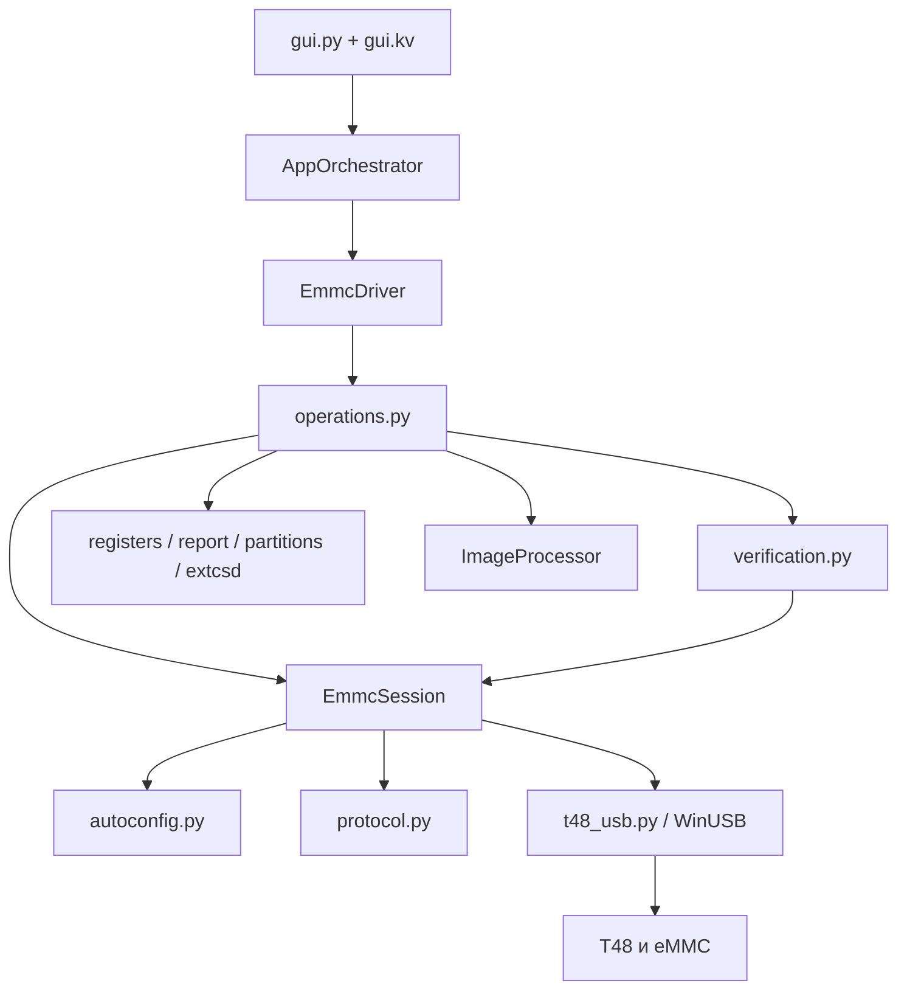

# Архитектура и протокол

[К оглавлению](../README.md)

## 1. Слои приложения



| Файл | Ответственность |
|---|---|
| `gui.py` | Свойства интерфейса, диалоги файлов, действия, вывод журнала |
| `gui.kv` | Дерево экранов, таблицы, кнопки, привязки, стили |
| `ui_theme.py` | Палитры и контраст текста |
| `ui_log.py` | Безопасный markup, уровни, фильтрация и шрифт журнала |
| `orchestrator.py` | Блокировка параллельных задач, поток, STOP, полные операции |
| `modes/emmc_mode.py` | Фасад `EmmcDriver` для оркестратора |
| `operations.py` | Высокоуровневые чтение, запись, стирание, EXT_CSD |
| `session.py` | Жизненный цикл устройства, init, регистры, выбор области, потоки |
| `protocol.py` | Константы, шаблоны и сборка команд |
| `autoconfig.py` | Выбор режима и кеш процесса |
| `verification.py` | Потоковый readback и сравнение регионов файла |
| `write_files.py` | Автопоиск файлов и проверка размера |
| `registers.py` / `report.py` | Декодирование идентификации и текстовый отчёт |
| `partitions.py` | GPT/MBR и сигнатуры ФС |
| `extcsd.py` | Формат снимка, сравнение, валидация и план настроек |
| `image_processor.py` | Карта RAW и частичный Sparse-парсер |
| `t48_usb.py` | Поиск устройства, WinUSB, дескрипторы, тайм-ауты, отмена |

Файлы NAND/SPI — заготовки, не завершённые драйверы. `scatter_to_gpt.py` сохранён как инструмент, но его кнопка удалена из GUI.

## 2. Фоновые задачи и состояние

`AppOrchestrator.run_task` захватывает `_operation_lock` без ожидания. Если задача уже идёт, новая отклоняется сообщением. Запрос STOP очищается перед новой задачей. Задача запускается в daemon-потоке, ошибки логируются, в `finally` снимается блокировка и сообщается завершение.

`usb_operation(stop_event)` связывает новые экземпляры USB-устройства с событием текущего потока через thread-local. `_OperationFeedback` передаёт текст и необязательные числовые callback `progress`/`phase`. GUI переносит изменения свойств в поток Kivy через `Clock.schedule_once`.

Daemon-поток не является гарантией безопасного завершения при принудительном закрытии процесса. Ожидаемый способ прерывания — STOP и ожидание завершения задачи.

Параметры `P.DEFAULT_*` изменяются GUI и используются новой сессией. Уже созданная сессия хранит собственные `preset`, `clock_mhz`, `legacy_30`.

## 3. WinUSB

Устройство ищется в реестре `HKLM\SYSTEM\CurrentControlSet\Control\DeviceClasses` по VID `A466`, PID `0A53`. Для найденных путей вызываются CreateFileW и WinUsb_Initialize. Поведение выбора среди нескольких T48 не является отдельным пользовательским селектором; порядок найденных путей не следует считать стабильным.

| Endpoint | Назначение |
|---|---|
| 0x01 | Команды OUT |
| 0x02 | Данные записи OUT |
| 0x81 | Ответы команд IN |
| 0x82 | Данные чтения IN |

Для всех endpoint при открытии задаётся тайм-аут 1500 мс. Некоторые команды временно устанавливают 30000 мс на командном IN, затем возвращают 1500 мс. Время всей операции может быть больше одного USB-тайм-аута из-за циклов ожидания и нескольких обменов.

`write_pipe` проверяет полный объём отправки, ошибку WinUSB и короткую передачу. Чтение возвращает фактические байты, а сессионные методы проверяют ожидаемую длину/формат там, где это реализовано. Наличие проверки в одном методе не означает полную валидацию каждого ответа всего протокола.

## 4. Сессия и перезапуск

Обычный жизненный цикл: `open → init_hw → wake_registers → select_partition → операция → close`.

`close` пытается отключить питание, подавляет ошибку этого завершающего действия и всегда освобождает USB. Поэтому отсутствие предупреждения не доказывает, что power-off физически выполнен.

`restart` используется перед верификацией:

1. Сохраняет последний CID.
2. Отправляет `04 00 00 00 00 00 00 00` и ожидает ответ.
3. Только при OSError 121 чтения ответа закрывает и открывает USB повторно.
4. Выдерживает паузу 0.3 с, повторяет init и чтение регистров.
5. Сравнивает CID с прежним.

Переоткрытие USB не является измерением снятия питания. Оно восстанавливает транспорт и позволяет продолжить только при корректных регистрах и последующем readback.

## 5. Инициализация и регистры

`init_hw` разрешает 1-bit/4-bit и частоты 8/16/20/30. При 30 МГц требует `is_18v=True`. Применяются служебные пакеты, выбранный PRESET_SETUP, конфигурация напряжения/шины, подтверждение конфигурации и команда 0x21 с селектором частоты. Ответ 0x21 должен иметь длину 8 и начало `21 00`.

`wake_registers` выполняет CID, CSD, EXT_CSD. Для Legacy 30 после CID отправляет CMD6 `HS_TIMING=0`, ждёт подтверждение и 0.2 с перед CSD. CID должен иметь длину 32 и начало `07 00`, CSD — 24 и начало `06 00`.

EXT_CSD получается из чтений 512 + 8 байт bulk-потока с удалением 8-байтового заголовка. На 30 МГц дополнительно проверяются HS_TIMING, допустимый BUS_WIDTH и ненулевая ёмкость. Стандартный пресет допускает BUS_WIDTH 0 либо ожидаемое значение по наблюдавшимся захватам; это не доказательство физической ширины шины.

## 6. Автоподбор

Кеш `_selected` содержит пару `(is_18v, bus_width)` и кортеж `(preset, clock, legacy)`. Он общий для процесса и не содержит CID.

Алгоритм `detect`:

1. Удалить прежний кеш.
2. Перебрать стандартный и THGA на 8 МГц до первого успешного эталона.
3. Проверить геометрию, затем прочитать начало, середину и конец User Area: по одной выровненной порции 16 КиБ, каждую дважды.
4. Перебирать частоты 30 → 20 → 16 при VCCQ 1.8 V, иначе 20 → 16. На каждой сначала стандартный, затем THGA; для 30 дополнительно THGA Legacy.
5. Сравнить CID/CSD, EXT_CSD_REV, DEVICE_TYPE, SEC_COUNT, BOOT_SIZE_MULT, ERASED_MEM_CONT и данные с эталоном.
6. Выбрать первый прошедший быстрый режим либо сохранить 8 МГц.
7. Повторно проверить победителя, сбросить/инициализировать и записать кеш.

Между попытками выполняется best-effort power-off. Отсутствие его подтверждения допускается с проверкой STOP. Запись и стирание данных при подборе не выполняются; инициализация меняет volatile-настройки eMMC.

Контроль нескольких участков не является полным сканированием поверхности. Выбор не проверяет надёжность записи и может быть недостаточным на однородной пустой памяти. Кеш сохраняется до сброса/замены параметров/завершения процесса, не выполняя автоматическую проверку личности нового чипа.

## 7. Потоки и STOP

При чтении setup содержит LBA и число порций. Каждая порция принимается как 16384 байта + 16 байт хвоста; первые 16 байт первого буфера — служебные, чистые данные собираются как `big.raw[16:] + tail.raw`.

Перед записью `_write_region` заранее читает с диска пакет до 1 МиБ, затем объявляет точное число порций. Каждая отправка содержит 16-байтовый заголовок и 16 КиБ данных. После всех порций опрашивается готовность 0x39; `resp[9] == 0x09` завершает поток.

`begin_write` под общей блокировкой помечает `_write_active`. STOP во время этого интервала не вызывает AbortPipe и не прерывает уже объявленный поток. `wait_write_complete` снимает флаг в `finally`. Следующий поток не начинается при запросе отмены. Для остального ввода-вывода `cancel_operation` вызывает AbortPipe; очистку дескрипторов выполняет владеющий рабочий поток.

Протокол не предоставляет транзакционного отката уже переданных данных. Ошибка USB во время активного потока может оставить неопределённое состояние операции.

## 8. Основные константы и команды

Справочник относится к реализованной последовательности T48, а не к полному публичному стандарту USB-протокола производителя.

| Назначение | Значение |
|---|---|
| Селекторы частоты | 8:00, 16:02, 20:03, 30:04 |
| Выключение питания | `0400000000000000` |
| Legacy timing | `274600000000b903` |
| BOOT1 | `274600000001b301` |
| BOOT2 | `274600000002b301` |
| RPMB | `274600000003b301` |
| User Area | `274600000007b302` |
| Подготовка стирания | `274d010000000100` |
| Опрос записи | `3900000000000000` |
| Чтение EXT_CSD | `0848000200000000` |

`switch_byte_cmd(index, value)` собирает `27 46 00 00 00 value index 03`; индексы выше 255 не записываются этим CMD6. Адреса потоков и числа порций упаковываются как 32-битные little-endian в шаблонах protocol.py.

Не следует переносить команду из исследовательского дампа в рабочий сценарий только по сходству байтов. Значение ряда полей и применимость к разным режимам T48 установлены лишь частично.

## 9. Программный API

Основные методы `EmmcDriver`:

```python
read_info_and_partitions(is_18v, bus_width, abort_check=None)
read_extcsd(is_18v, bus_width, abort_check=None)
write_extcsd(is_18v, bus_width, index, value, expected_data,
             expected_cid, abort_check=None, allow_otp=False)
dump_boot(is_18v, bus_width, part_name, size_bytes, out_path,
          abort_check=None, verify=False)
dump_user_area(is_18v, bus_width, out_path, abort_check=None, verify=False)
dump_lba_range(is_18v, bus_width, part_name, start_lba, end_lba,
               out_path, abort_check=None, verify=False)
write_partition(is_18v, bus_width, part_name, in_path,
                abort_check=None, verify=False, erase_before=False)
write_lba_range(is_18v, bus_width, part_name, start_lba, end_lba,
                in_path, abort_check=None, verify=False, erase_before=False)
erase_blocks(is_18v, bus_width, part_type, start_lba, end_lba,
             abort_check=None)
```

`read_info_and_partitions` возвращает `(info, parts)`, EXT_CSD — `(data, cid)` или None, успешная полная запись области и основные дампы возвращают True. Возвраты разных маршрутов неоднородны: фасад диапазонов/стирания не пробрасывает результат, а ряд операций ловит ошибки и пишет их в журнал. Нельзя строить единый внешний API только на предположении, что отсутствие исключения означает успех.

Для доступа к оборудованию из нового рабочего потока нужен тот же контекст отмены и сериализация. Не запускайте примеры прямого API параллельно GUI. При изменении реализации обновляйте и документацию поведения, и соответствующие существующие smoke-тесты.
